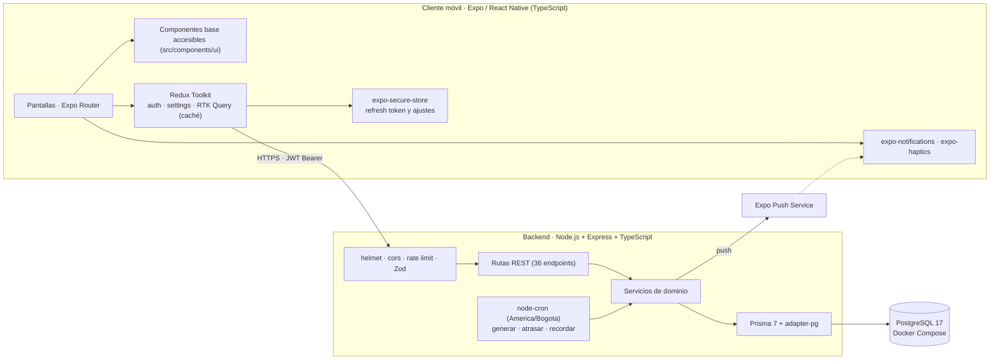
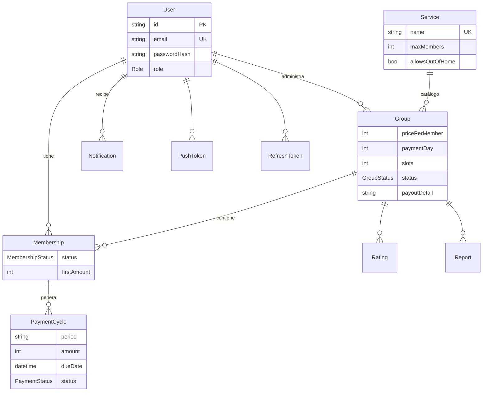

# Cuotix: Documento Técnico Final

**Asignatura:** Desarrollo de Aplicaciones Móviles · **Institución:** Universidad de La Sabana, Facultad de Ingeniería
**Entrega:** Fase 3, Tercer Corte (Entrega Final Definitiva)
**Equipo:** David Alejandro Castiblanco, Jorge Montalvo, Jacobo Acosta
**Repositorio:** https://github.com/jfontx/cuotix

> **Convención de este documento.** Todo lo afirmado aquí se verificó en el código o en la ejecución de las pruebas del repositorio. Lo que no se hizo se declara como limitación (sección 5.2).

---

## 1. Consolidación de Visión del Producto, Problema y Estado del Arte

### 1.1 Resumen ejecutivo y propuesta de valor

**Cuotix** es una aplicación móvil que centraliza la organización de grupos para compartir el costo de suscripciones digitales (streaming, música, software). **Tagline:** *Comparte tus suscripciones, paga solo tu cuota.*

La propuesta de valor es la **conveniencia centralizada**: una sola plataforma para buscar grupos con cupos, solicitar acceso, hacer seguimiento de cuotas con recordatorios y consultar la reputación de la otra parte, en lugar de fragmentar esa coordinación entre chats, hojas de cálculo y calendarios (DEC-002). Cuotix opera exclusivamente dentro de los planes multiusuario que cada servicio permite oficialmente (planes familiares, miembros extra); no facilita el uso compartido no autorizado.

**Roles de usuario**

| Rol | Necesidad | Qué hace en Cuotix |
|---|---|---|
| Administrador | Recuperar parte del costo de la suscripción que paga | Publica el grupo, aprueba solicitudes, confirma pagos, califica |
| Miembro | Acceder a un servicio pagando solo una fracción | Busca y solicita unirse, confirma acceso, marca sus pagos, califica |
| Admin interno | Mantener la comunidad segura | Modera reportes (solo vía API en el MVP) |

**User personas.** El equipo no definió personas formales en esta etapa (DEC-004). Los roles anteriores son arquetipos funcionales, no personas construidas con investigación de usuarios. Para el diseño inclusivo se tomaron como objetivos tres perfiles de necesidad de accesibilidad: *usuarios de lector de pantalla* (VoiceOver/TalkBack), *usuarios de baja visión* (contraste, escalado de texto) y *usuarios con motricidad reducida* (áreas táctiles amplias).

### 1.2 Síntesis del problema y análisis competitivo

Compartir suscripciones ocurre hoy de manera informal por WhatsApp o Facebook, con cuatro problemas: no hay control de cupos, el administrador persigue manualmente a quienes no pagan, no existe reputación verificable y la oferta está fragmentada. **Limitación declarada:** la existencia del problema se validó por investigación informal en internet; no se cuenta con encuestas propias ni métricas de grupos existentes (DEC-003).

| Criterio | Grupos informales (WhatsApp/Facebook) | Cuotix (versión final) |
|---|---|---|
| Control de cupos | Manual, sin validación | Automático y transaccional: no se aprueban más miembros que cupos (bloqueo de fila `FOR UPDATE`) |
| Seguimiento de pagos | Por chat | Estados de cuota (`PENDING`, `MARKED_PAID`, `CONFIRMED`, `OVERDUE`, `CANCELLED`), confirmación doble y atraso automático |
| Recordatorios | Manuales | Job diario: aviso 2 días antes, el día del vencimiento y al caer en mora, sin duplicados |
| Reputación | Inexistente | Calificaciones bidireccionales por grupo y reportes |
| Descubrimiento | Depende de conocer al administrador | Explorar con búsqueda y filtro por servicio |
| Protección al miembro | Ninguna | La primera cuota solo se genera cuando el miembro confirma que tiene acceso |
| Datos de cobro | Públicos en el chat | Visibles solo para el administrador y miembros con cupo |
| Accesibilidad | No aplica | Diseñada desde la base (sección 3) |

**Alcance de la comparación.** La alternativa real contra la que compite Cuotix es la coordinación informal por grupos de WhatsApp o Facebook, que es la que se contrasta aquí. No se analizaron plataformas formales de suscripciones compartidas (limitación declarada en la sección 5.2).

### 1.3 Innovación lograda frente al estado del arte

Con pagos manuales, el valor no está en mover dinero sino en **organizar y dar confianza** alrededor del pago:

1. **Cupos como invariante del sistema.** La aprobación se serializa con un bloqueo de fila y una verificación dentro de la transacción; solicitudes simultáneas no pueden sobrepasar el cupo.
2. **Doble confirmación de pago.** El miembro marca "ya pagué" y el administrador confirma o rechaza con motivo; el sistema nunca declara un pago como cierto por sí solo.
3. **Protección al miembro por diseño.** No se cobra ni genera cuota hasta confirmar acceso.
4. **Ciclo mensual idempotente.** Generación de cuotas, marcado de atrasos y recordatorios son tareas repetibles sin efectos duplicados (restricciones únicas en base de datos).
5. **Decisión de ingeniería documentada (DEC-001).** Cuotix no procesa ni custodia dinero. Se descartó la pasarela con pago retenido por comisiones desproporcionadas en cuotas pequeñas, riesgo regulatorio y alcance; se compensa con reputación y confirmación doble. Es una evolución justificada del producto, no una omisión.

---

## 2. Arquitectura de Software Móvil e Implementación Técnica

### 2.1 Diagrama de arquitectura end-to-end



La solución corre en local: PostgreSQL y la API con Docker Compose; la app en simulador/emulador o dispositivo físico en la misma red (la URL de la API se configura con `EXPO_PUBLIC_API_URL`; ver README).

### 2.2 Decisiones arquitectónicas y estructura de componentes

| Tema | Decisión | Justificación |
|---|---|---|
| Navegación | **Expo Router** (rutas por archivo en `src/app/`), grupos `(auth)` y `(app)` con `Stack.Protected` según sesión; pestañas Inicio, Explorar, Notificaciones y Perfil | Rutas declarativas; la protección por sesión evita acceder a pantallas internas sin autenticarse |
| Estado global | **Redux Toolkit + RTK Query** | Una sola herramienta para estado del cliente (sesión, tema, accesibilidad) y del servidor (caché, invalidación por tags, reintentos); alternativas evaluadas en el plan |
| Estado asíncrono | RTK Query con `providesTags`/`invalidatesTags`; petición de renovación de sesión única en vuelo ante un 401 | Las listas se actualizan tras mutaciones (p. ej. aprobar cambia los cupos) sin recargas manuales |
| Sesión | Access token (15 min) solo en memoria; refresh token (7 días) en `expo-secure-store`, rotado en cada uso; reutilización detectada revoca todos los tokens | Minimiza la superficie de robo de credenciales |
| Validación | **Zod** en backend (entradas) y en formularios móviles | Un esquema por contrato; mensajes de error claros |
| Rendimiento en listas | `FlatList` con componente `AppList` (separación uniforme, estado vacío, rol de lista), paginación en `GET /groups`, `pull to refresh` y caché de RTK Query | Evita renderizar de más y repetir peticiones |
| Ajustes del usuario | `settingsSlice` persistido (tema, alto contraste, vibración) | Las preferencias de accesibilidad sobreviven al cierre de la app |

**Organización del código**

```
src/app/            Rutas (auth, tabs, groups, payments, ratings, reports, users)
src/components/ui/  Componentes base accesibles (AppButton, AppInput, AppCard, StatusBadge, AppText, AppScreen, AppModal, AppRating, AppSwitch, AppChip…)
src/store/          Slices (auth, settings) y APIs de RTK Query por dominio
src/theme/          Tokens: colores (claro, oscuro, alto contraste), tipografía, espaciado
src/lib/            Háptica, push, almacenamiento seguro, validación, formato
backend/src/        routes · services · schemas (Zod) · middleware · jobs · lib
backend/prisma/     schema.prisma, migraciones, seed y seed de demo
```

### 2.3 Modelo de datos y contratos de servicio



Restricciones clave: `Membership(groupId,userId)` único, `PaymentCycle(membershipId,period)` único (idempotencia del ciclo), `Rating(groupId,fromId,toId)` único (una calificación por par y grupo), `Notification(userId,type,paymentId)` único (sin recordatorios duplicados).

**Máquinas de estado**

- *Membresía:* `PENDING → APPROVED → ACTIVE → (LEFT | REMOVED)`; `PENDING → REJECTED`. Expulsar exige dos cuotas vencidas consecutivas.
- *Cuota:* `PENDING → MARKED_PAID → CONFIRMED`; el administrador puede rechazar (`MARKED_PAID → PENDING` con motivo); `PENDING → OVERDUE` tras 3 días de gracia; `OVERDUE → MARKED_PAID` (pago tardío); `CANCELLED` al cerrar el grupo, salir o ser removido.

**Contratos de servicio.** 36 endpoints REST agrupados en `auth`, `me`, `services`, `groups`, `memberships`, `payments`, `ratings`, `reports`, `notifications` y `users`, descritos en `docs/openapi.yaml` (OpenAPI 3.0). Un test verifica que la especificación cubra exactamente las rutas del código. Los errores usan un contrato único `{ error: { code, message } }` con códigos de dominio (`group/full`, `payment/already-confirmed`, `rate-limit/exceeded`, etc.).

**Seguridad.** Contraseñas con Argon2id; JWT firmados con secretos por entorno; limitación de tasa en login, registro y refresh; `helmet`; autorización verificada contra la base de datos en cada recurso; `payoutDetail` expuesto únicamente al administrador y a miembros con cupo (A.7), con pruebas de autorización; ningún secreto versionado (`.env` ignorado).

---

## 3. Implementación y Auditoría de Accesibilidad Móvil

### 3.1 Cumplimiento de pautas (WCAG 2.1/2.2 adaptadas a móvil)

Las mejoras se resolvieron una sola vez en **componentes base** que toda pantalla reutiliza, de modo que el cumplimiento es estructural y no pantalla por pantalla.

**Semántica para lectores de pantalla.** `AppButton` (rol `button`, etiqueta = título, estados `disabled` y `busy`), `AppInput` (etiqueta visible; "requerido" en la etiqueta accesible; error en región `polite`), `AppCard` (un único foco con resumen completo: rol `summary` o `button`), `StatusBadge` (estado con icono distinto + texto), `AppSwitch` (rol `switch` con `checked`), `AppChip` (`selected`), `AppRating` (cada estrella como `radio` "N estrellas"; en lectura, un solo elemento "Calificación: X de 5"), `AppScreen` (carga anunciada como `progressbar`; error como `alert` en región `assertive`), `AppModal` (`accessibilityViewIsModal`, fondo oculto al lector) y `AppIcon` (decorativo oculto, o con etiqueta).

**Contraste y tipografía.** Los tokens de color se verificaron calculando la relación de contraste WCAG con los valores reales de `src/theme/colors.ts`:

| Par (texto / fondo) | Claro | Oscuro | Alto contraste claro | Alto contraste oscuro |
|---|---|---|---|---|
| Texto principal / fondo | 16,74:1 | 18,92:1 | 21,00:1 | 21,00:1 |
| Texto secundario / fondo | 7,30:1 | 13,26:1 | 15,17:1 | 19,25:1 |
| Texto sobre botón primario | 5,30:1 | 7,17:1 | 13,57:1 | 9,18:1 |
| Color de error / fondo | 6,19:1 | 10,41:1 | 10,02:1 | 14,52:1 |

Todos superan 4,5:1 (AA). Los cinco estados de cuota (insignias) van de 6,84:1 a 8,01:1 en claro y de 6,01:1 a 11,70:1 en oscuro. `AppText` activa `allowFontScaling` y los estilos definen `lineHeight` explícito por variante para evitar recortes con fuentes grandes. El estado nunca depende solo del color: las cuotas combinan icono y texto, los chips seleccionados añaden "✓" y las estrellas distinguen ★/☆ por glifo.

**Ergonomía táctil y retroalimentación.** Altura mínima de 48 dp en botones, entradas, interruptores y chips, con `hitSlop` de 8 dp en controles pequeños (`src/theme/spacing.ts`). Háptica opcional (`expo-haptics`) con éxito/error en las acciones relevantes, desactivable en Perfil y tolerante a fallos del motor háptico. Perfil permite tema Sistema/Claro/Oscuro y **alto contraste**, persistidos.

**Límites reconocidos.** No se implementó `reduceMotion` (la app no define animaciones propias); `eslint-plugin-react-native-a11y` no está integrado en CI (**decisión pendiente**).

### 3.2 Matriz trazable (propuesta del Segundo Corte vs. implementación final)

*Verificación automática:* test de componentes en `__tests__/` con React Native Testing Library. La verificación de cada fila es la prueba automatizada indicada, más el uso manual de la app en dispositivo descrito en la sección 4.

| # | Mejora propuesta | Implementación (archivo) | Prueba automatizada | WCAG |
|---|---|---|---|---|
| 1 | Rol y etiqueta en botones | `src/components/ui/app-button.tsx` | `ui.test.tsx` › AppButton: rol y label | 4.1.2 |
| 2 | Estado disabled/loading anunciado | `app-button.tsx` | `ui.test.tsx`: `disabled`, `busy`, "Cargando" | 4.1.2 |
| 3 | Labels visibles en inputs | `app-input.tsx` | `ui.test.tsx` › AppInput: label visible | 3.3.2 |
| 4 | Errores anunciados | `app-input.tsx` (región `polite`) | `ui.test.tsx`: error en región live | 3.3.1 |
| 5 | Errores no solo con color | `app-input.tsx` (icono + texto) | `ui.test.tsx`: error con icono y texto | 1.4.1 |
| 6 | Cards como foco único | `app-card.tsx`, `group-card.tsx`, `payment-card.tsx` | `ui.test.tsx` › AppCard; `group-card.test.tsx` | 2.4.6 |
| 7 | Estados con icono + texto | `status-badge.tsx` | `ui.test.tsx`: icono distinto por estado | 1.4.1 |
| 8 | Contraste ≥ 4,5:1 | `src/theme/colors.ts` | Cálculo de contraste (tabla 3.1) | 1.4.3 |
| 9 | Tipografía escalable | `app-text.tsx`, `typography.ts` | `ui.test.tsx`: `allowFontScaling` | 1.4.4 |
| 10 | Áreas táctiles ≥ 48 dp | `app-button.tsx`, `app-input.tsx`, `app-switch.tsx`, `app-chip.tsx` | `ui.test.tsx`: `minHeight ≥ 48` | 2.5.5 |
| 11 | `hitSlop` en elementos pequeños | `spacing.ts`; `app-chip.tsx`, `app-rating.tsx`, `app-modal.tsx` | Revisión de código | 2.5.5 |
| 12 | Orden de foco lógico | Todas las pantallas (`src/app/`) | — | 2.4.3 |
| 13 | Foco en modal al abrir | `app-modal.tsx` (`accessibilityViewIsModal`) | `ui.test.tsx` › AppModal | 2.4.3 |
| 14 | Foco tras cerrar modal | `app-modal.tsx` | — (no implementado de forma explícita) | 2.4.3 |
| 15 | Headers semánticos | `app-text.tsx` (h1–h3 → `header`) | `ui.test.tsx`: rol `header` | 2.4.6 |
| 16 | Mensajes de carga | `app-screen.tsx` | `ui.test.tsx` › AppScreen: carga | 4.1.3 |
| 17 | Mensajes de error | `app-screen.tsx`, formularios | `ui.test.tsx`: `assertive`, reintento | 4.1.3 |
| 18 | Retroalimentación háptica | `src/lib/haptics.ts`, `app-button.tsx`, `app-switch.tsx` | `profile-screen.test.tsx` › háptica | UX |
| 19 | Alto contraste | `colors.ts`, `theme-provider.tsx`, `profile.tsx` | `profile-screen.test.tsx` › alto contraste | 1.4.3 |
| 20 | Lint de accesibilidad en CI | — | **No integrado** (decisión pendiente) | Auto |

---

## 4. Pruebas Funcionales, Rendimiento y Validación de Usuario

### 4.1 Pruebas ejecutadas

Resultados de la última ejecución en el repositorio (`npm test` en la raíz y en `backend/`; `npx tsc --noEmit` y `npx expo lint` sin errores):

| Capa | Herramienta | Suites | Pruebas | Resultado |
|---|---|---|---|---|
| Backend: unitarias e integración | Jest + Supertest, PostgreSQL real | 19 | 215 | Todas pasan |
| Móvil: componentes, pantallas y store | jest-expo + React Native Testing Library | 13 | 197 | Todas pasan |

Cobertura funcional: autenticación (registro, login, rotación y revocación de tokens, rate limit), grupos y cupos concurrentes, membresías y transiciones, cuotas y autorización de `payoutDetail`, jobs idempotentes (generación, atraso, recordatorios), calificaciones y reportes, notificaciones, y consistencia entre OpenAPI y rutas. En móvil: componentes base, formularios, flujos de cada pantalla, persistencia de ajustes y redirección al login sin sesión.

**Flujos de negocio de extremo a extremo.** Se redactaron cinco guiones manuales (`docs/E2E_TESTS.md`): registro/login, crear grupo y recibir miembro, ciclo de pago completo, manejo de errores y accesibilidad, más una guía por funcionalidad (`docs/GUIA_DE_PRUEBAS.md`) que usa datos de demostración reproducibles (`npm run db:reset-demo`). Los tres integrantes del equipo ejecutaron las pruebas manuales sobre un iPhone con Expo Go, contra el backend local con esos datos de demostración.

**Manejo de errores cubierto por pruebas:** credenciales inválidas, validación de formularios, cupo agotado, transiciones inválidas, límite de intentos y errores de servidor mostrados en pantalla. La condición "sin red" está prevista en el guion E2E-4.

**Rendimiento.** No se realizaron mediciones cuantitativas de rendimiento. Las decisiones aplicadas (caché de RTK Query, paginación, `FlatList`, una sola renovación de sesión en vuelo) están justificadas por diseño, no medidas.

### 4.2 Auditoría de accesibilidad

La verificación de accesibilidad se apoya en tres fuentes: (1) pruebas automatizadas de roles, etiquetas, estados, tamaños y regiones live en los componentes base (matriz 3.2); (2) el cálculo de contraste de los tokens de color (sección 3.1); y (3) el uso manual de la app en el iPhone durante las pruebas de la sección 4.1, incluyendo el cambio de tema y el modo de alto contraste. No se documentó una sesión dedicada con VoiceOver o TalkBack, por lo que la lectura asistida de las pantallas no se presenta como evidencia (sección 5.2).

---

## 5. Conclusiones, Limitaciones y Trabajo Futuro

### 5.1 Alcance logrado y lecciones aprendidas

Se construyó un producto de extremo a extremo: API propia con 36 endpoints, base de datos relacional con migraciones, tareas programadas, notificaciones, y una aplicación móvil con sesión segura, gestión de grupos, membresías, cuotas, calificaciones y reportes; sin datos simulados en la aplicación, que consume la API real. La accesibilidad se resolvió en componentes base reutilizables, lo que mantuvo el costo bajo y el cumplimiento uniforme.

Retos de ingeniería superados:
- **Concurrencia de cupos:** resuelta con bloqueo de fila y transacción en lugar de comprobaciones fuera de ella.
- **Idempotencia de jobs:** restricciones únicas y `createMany` con `skipDuplicates` para poder reejecutar sin duplicar.
- **Zona horaria:** fechas de vencimiento y recordatorios calculadas en hora de Bogotá, sin depender de la del servidor.
- **Rotación de refresh tokens con peticiones concurrentes:** consumo atómico del token y una sola renovación en vuelo en el cliente.
- **Rutas protegidas:** sin sesión, la ruta raíz no se resolvía y caía en "pantalla no existe"; se detectó en pruebas manuales y se corrigió redirigiendo al login. Muestra el valor de probar el árbol de rutas completo, que las pruebas unitarias no cubrían.

### 5.2 Limitaciones

- Evidencia del problema basada en investigación informal; sin personas formales ni análisis de plataformas competidoras formales (DEC-003 a DEC-005).
- Los pagos son manuales: Cuotix no verifica transferencias.
- No se documentó una auditoría dedicada con VoiceOver/TalkBack ni un piloto con usuarios; las pruebas manuales se hicieron en un iPhone con Expo Go.
- No se analizaron plataformas formales de suscripciones compartidas (Together Price, ShareSub, Spliiit); se desconoce su funcionamiento en Colombia (DEC-005).
- Notificaciones push reales y enlaces profundos requieren un build de desarrollo (no funcionan en Expo Go).
- La app no tiene pantalla para editar los datos de un grupo (solo pausar/reanudar), aunque el backend la soporta; no hay recuperación de contraseña ni panel de moderación en la app.
- Sin lint de accesibilidad en integración continua; `reduceMotion` no implementado.

### 5.3 Hoja de ruta

1. Pasarela de pagos con cobros recurrentes tokenizados y, eventualmente, pago retenido (previa asesoría regulatoria).
2. Verificación de identidad y subida de comprobantes de pago.
3. Recuperación de contraseña y edición completa de grupos.
4. Panel de moderación y de métricas.
5. Despliegue en la nube con tareas programadas gestionadas.
6. Alertas de cambios de política de los servicios y ampliación del catálogo curado.
7. Integración del lint de accesibilidad en CI y pruebas regulares con lectores de pantalla.

---

## Referencias

[1] W3C, "Web Content Accessibility Guidelines (WCAG) 2.2," W3C Recommendation, 2023. [Online]. Available: https://www.w3.org/TR/WCAG22/
[2] W3C, "Web Content Accessibility Guidelines (WCAG) 2.1," W3C Recommendation, 2018. [Online]. Available: https://www.w3.org/TR/WCAG21/
[3] Meta Platforms, "Accessibility," React Native Documentation. [Online]. Available: https://reactnative.dev/docs/accessibility
[4] Expo, "Expo Router," Expo Documentation. [Online]. Available: https://docs.expo.dev/router/introduction/
[5] Redux Toolkit, "RTK Query Overview." [Online]. Available: https://redux-toolkit.js.org/rtk-query/overview
[6] Prisma, "Prisma ORM Documentation." [Online]. Available: https://www.prisma.io/docs
[7] Expo, "SecureStore," Expo Documentation. [Online]. Available: https://docs.expo.dev/versions/latest/sdk/securestore/
[8] Cuotix, `docs/DECISIONS.md`, `docs/IMPLEMENTATION_SPEC.md`, `docs/UI_ACCESSIBILITY_SPEC.md`, `docs/openapi.yaml`, repositorio del proyecto, 2026.
